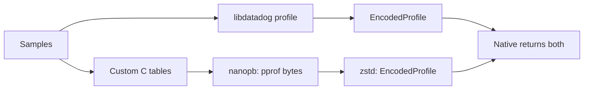

# Miteruby: a second path from samples to pprof

**Goal:** connect the custom encoder and compressor, and check their output against libdatadog.

- Already on the branch: nanopb, bundled zstd, and `EncodedProfile.from_custom`.
- Added: custom profile storage, dual serialization, and equivalence tests.
- Ruby callers continue receiving the libdatadog result.

---

## 1. Same inputs, two encoders

Libdatadog's profile is opaque, so the custom path keeps its own data. Libdatadog serializes without the GVL; the custom encoder runs after reacquiring it. Both outputs use the same start and finish timestamps; Ruby selects the first result.

---

## 2. Preserve the meaning of the samples

- Deduplicate strings, mappings, functions, and locations into pprof tables.
- Aggregate matching untimestamped samples, with integer saturation; keep timestamped samples separate.
- Preserve string and numeric labels, plus sample timestamps.

The custom representation lives in [custom_profile.c](../custom_profile.c); [libdatadog_recorder.c](../libdatadog_recorder.c) feeds both paths.

---

## 3. Encode, compress, hand over

1. Nanopb callbacks supply repeated fields from the C tables.
2. Calculate the encoded size and allocate the complete pprof buffer.
3. Encode into that buffer, then compress with zstd at level 1.
4. Pass the compressed bytes through `EncodedProfile.from_custom`.

**Scope:** custom protobuf encoding and compression. Packaging still uses the existing libdatadog-backed `EncodedProfile` bridge.

---

## 4. Make ownership explicit

- Native storage uses libc allocation; copied strings survive changes to their Ruby inputs.
- A linked allocation list tracks owned blocks; cleanup also frees resizable pointer arrays.
- `rb_ensure` frees custom profile data and releases serialization ownership even when constructing the Ruby result raises.

Each interval gets a fresh custom profile, allocated before serialization. Cleanup frees the old profile and installs its replacement without allocating while unwinding an exception. Fork reset also creates a fresh profile.

---

## 5. Deliberate trade-offs

| Decision | Benefit | Cost |
| --- | --- | --- |
| Record and encode twice | Direct comparison against libdatadog | Extra CPU and memory |
| Hold the GVL for custom encoding | Simple ownership and exception handling | Ruby execution waits during custom encoding |
| Build the whole pprof first | Straightforward sizing and compression | Higher peak memory |
| Arrays and linear searches | Small, inspectable implementation | Work grows poorly with larger profiles |
| Use libc allocations | Independent of the miteruby allocator | Outside its memory budget |

---

## 6. Evidence and next steps

**Comparison:** decompress both outputs, run `protoc --decode_raw`, and compare fields. Only top-level field order and sample order are ignored; empty profiles match exactly.

- Cases cover shared frames, labels, aggregation, GC, repeated flushes, fork reset, and exceptions.
- Trace identifiers and endpoint association are deferred until miteruby captures that data.
- Two unused string-table entries mirror libdatadog's defaults so decoded comparisons retain identical string IDs.

**Next:** measure performance before optimizing. Hash tables, buffer reuse, streaming, and releasing the GVL during custom encoding remain ideas in [Custom serializer ideas](OptimizationIdeas.md#custom-serializer-ideas).
